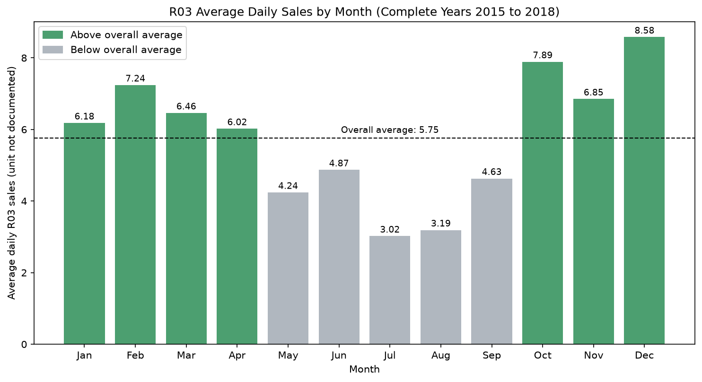
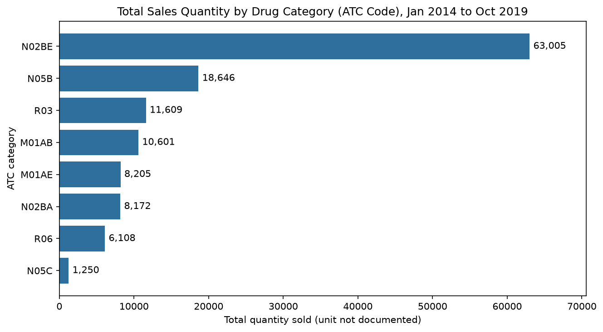
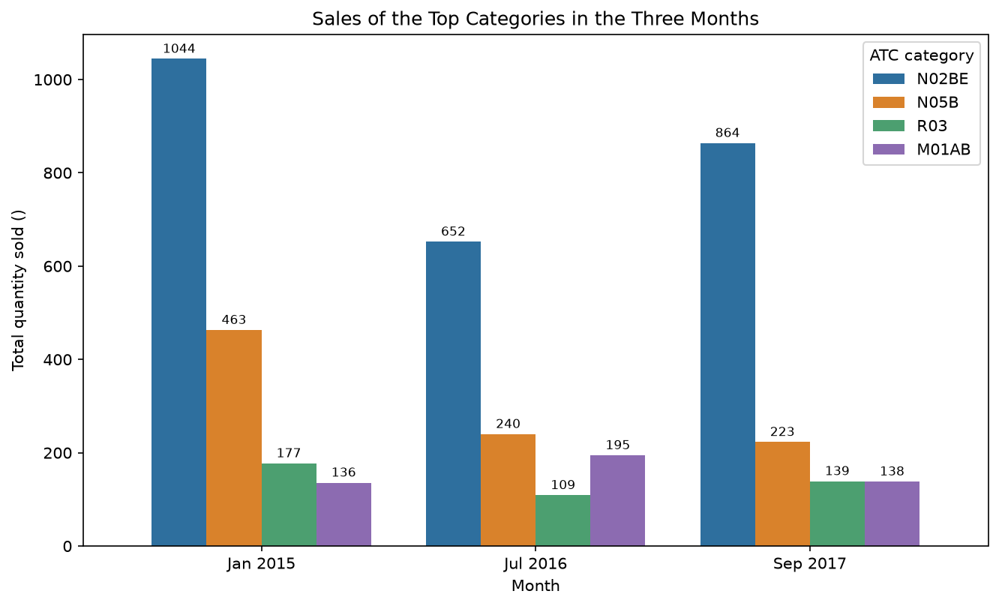
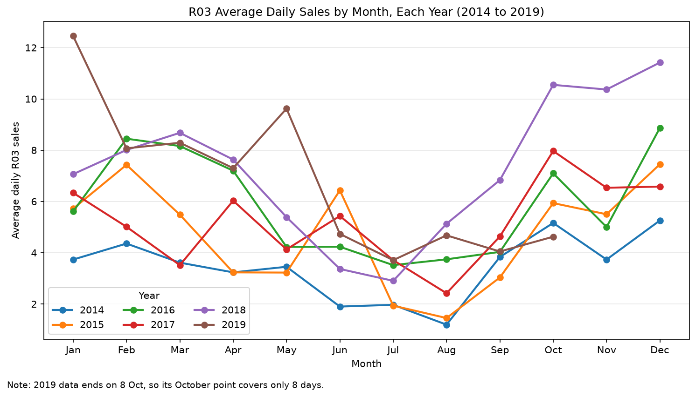
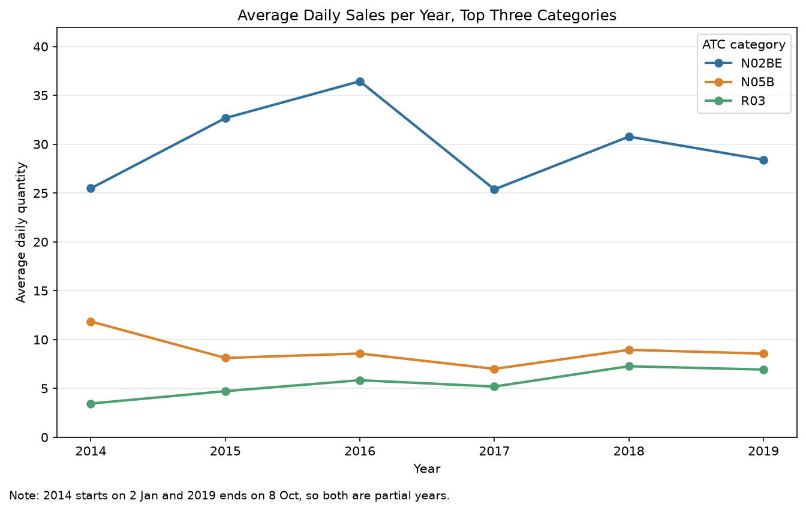

[README.md](https://github.com/user-attachments/files/35226049/README.md)
# Analysing Pharmaceutical Sales Data

A Python data analysis of six years of daily pharmacy sales, exploring which drug categories sell the most and whether respiratory drug sales (R03) follow a seasonal pattern.

**Author:** Tehan Wijeratne
**Original project and dataset:** https://www.kaggle.com/datasets/milanzdravkovic/pharma-sales-data



*Respiratory drug (R03) sales are above average from October to April and below average from May to September (complete years 2015 to 2018).*

---

## Project Overview

The dataset holds daily sales quantities for 8 drug categories, identified by ATC codes, from 2 January 2014 to 8 October 2019 (2,106 days). The Kaggle description says the sales come from a single pharmacy.

**Important limitation:** the data contains drug *categories*, not individual brands. Three of the six original questions mention "drugs" or "brands", so they were answered at the category level, and this is stated clearly in the notebook.

## Objectives

- Understand and check the quality of the dataset before analysing it
- Find the categories with the highest sales
- Compare categories fairly, using daily averages where years or months have different lengths
- Test whether R03 sales are seasonal
- Separate what the data shows from what might explain it

## Key Findings

- **N02BE dominates.** It sold 63,005 units, which is 49.4% of all sales. It had the highest daily average in every year from 2014 to 2019, and N05B was second in every year.
- **In 2017, N02BE was the top category** by total quantity (9,259 units) and by number of days with sales (361 of 365).
- **R03 sales are seasonal.** In the complete years 2015 to 2018, R03 averaged 7.03 per day from October to April and 3.98 per day from May to September. December was the highest month (8.58 per day) and July the lowest (3.02).
- **R03's daily average rose** from 3.45 in 2014 to 7.27 in 2018.
- **The data shows when, not why.** Possible explanations (such as respiratory illness in colder months) are labelled as hypotheses in the notebook, because the dataset has no weather or illness data.

## The Six Questions

| # | Question | Answer (category level) |
|---|---|---|
| 1 | Total sales for each drug category | N02BE 63,005 (49.4%), N05B 18,646 (14.6%), R03 11,609 (9.1%), M01AB 10,601 (8.3%), M01AE 8,205 (6.4%), N02BA 8,172 (6.4%), R06 6,108 (4.8%), N05C 1,250 (1.0%) |
| 2 | Which individual drug brands sold the most? | Cannot be answered, because there are no brand names. Answered for categories instead: N02BE, then N05B, then R03 |
| 3 | Top three in Jan 2015, Jul 2016 and Sep 2017 | N02BE and N05B first and second in all three months. Third place: R03 (Jan 2015), M01AB (Jul 2016), R03 (Sep 2017) |
| 4 | Which drug was sold most often in 2017? | N02BE, by both total quantity and days with sales |
| 5 | Highest average daily sales | N02BE, at 29.92 per day, about 3.4 times the second category (N05B, 8.85) |
| 6 | Is R03 sold more in specific months? | Yes. Higher from October to April, lower from May to September |

## Charts

| Total sales by category | Top categories in three months |
|---|---|
|  |  |

| R03 monthly pattern, each year | Yearly trend, top three categories |
|---|---|
|  |  |

## Technologies Used

- Python 3.12
- Pandas
- Matplotlib
- Jupyter Notebook
- Git and GitHub

## Project Structure

```text
Analysing-pharmaceutical-sales-data/
│
├── data/
│   └── README.md                  (how to get the dataset)
│
├── notebooks/
│   └── pharmaceutical_sales_analysis.ipynb
│
├── visualisations/                (saved charts)
│
├── README.md
├── requirements.txt
└── .gitignore
```

## Methodology

### Data preparation
- Converted the date column from text to dates (month/day/year) and verified the format: all rows converted, and the Year, Month and Weekday columns matched the new dates on every row.
- Found no missing values and no duplicate rows. The dataset description says it was already pre-processed before publishing, so this is expected.
- Confirmed exactly one row per day with no gaps (2,106 days, 2,106 rows).
- Kept zero-sales days and unusually high days, because there was no evidence of errors, and removing them would change the results.
- Did not use the `Hour` column, because the dataset does not explain it.

### Exploratory data analysis
- Filtering, sorting, grouping and aggregation with Pandas.
- Compared years and months using **daily averages**, because 2014 and 2019 are partial years and months have different lengths.
- For the seasonal analysis, used only the **complete years (2015 to 2018)**, built a seasonal index, and checked each year separately to confirm the pattern repeats.
- A simple monthly total over all the data wrongly makes January look highest, because it has more days and more years of data than December. The notebook shows this and explains the fix.

## How to Run This Project

1. **Clone the repository**
   ```bash
   git clone https://github.com/TehanWijeratne/Analysing-pharmaceutical-sales-data.git
   cd Analysing-pharmaceutical-sales-data
   ```
2. **Create and activate a virtual environment**
   ```bash
   python -m venv venv
   venv\Scripts\activate          # Windows
   source venv/bin/activate       # macOS / Linux
   ```
3. **Install the dependencies**
   ```bash
   pip install -r requirements.txt
   ```
4. **Add the dataset** (see below) so the file is at `data/salesdaily.csv`.
5. **Open the notebook**
   ```bash
   jupyter notebook
   ```
   Then open `notebooks/pharmaceutical_sales_analysis.ipynb` and choose **Kernel > Restart Kernel and Run All Cells**.

## Dataset Access

The dataset is **not included** in this repository. Download `salesdaily.csv` from the original Kaggle page and place it in the `data/` folder:

https://www.kaggle.com/datasets/milanzdravkovic/pharma-sales-data

A free Kaggle account may be needed. Please check the licence shown on the Kaggle page before reusing the data. Credit for the dataset goes to Milan Zdravković.

## Limitations

- **Categories, not brands.** Brand-level questions cannot be answered with this data.
- **Unknown units.** The unit of the sales quantities is not documented in the file, and many values are decimals.
- **Single pharmacy.** The results may not apply to other places. The location is not stated in the dataset description I read.
- **Already pre-processed.** The data was processed before publishing (outliers treated, missing values filled in), so it is not completely raw.
- **Partial years.** 2014 starts on 2 January and 2019 ends on 8 October.
- **Short history.** The seasonal pattern rests on four complete years, and it is not identical every year.
- **Unclear zeros.** A zero could mean no demand, no stock or a closed day.
- **Descriptive only.** The project shows what happened, not why, and it does not predict the future.

## Conclusion

One category, N02BE, accounts for almost half of all sales in this pharmacy's data and held the top position in every year. Respiratory drug (R03) sales show a clear seasonal pattern, with higher daily sales from October to April than from May to September, and December and July as the extremes. The analysis also shows why fair comparisons matter: raw monthly totals pointed to the wrong peak month until daily averages and complete years were used. The data shows *when* sales are higher but cannot explain *why*, so the next steps would need brand-level data, prices, stock levels and weather or illness data.
